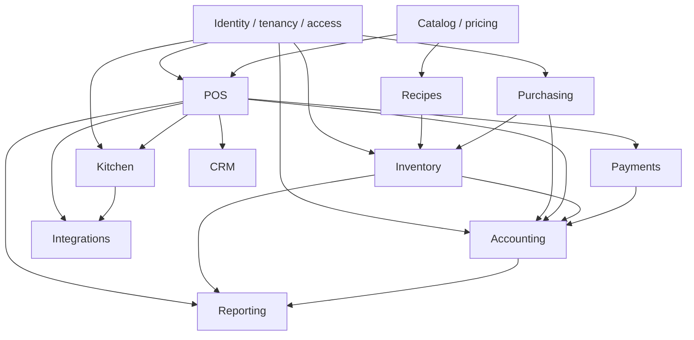

# Module Dependencies

Dependencies are one-way through application ports/events. Reporting may read projections but cannot mutate source modules. Accounting consumes approved business events; it never queries controller request payloads. Delivery adapters depend on integration contracts, not the order aggregate implementation.

## Implementation sequence

Identity/tenant/branch → catalog/pricing → POS/order state → verified payments → KDS → inventory/UOM → recipes/costing → purchasing → accounting → workforce/CRM → delivery adapters → advanced analytics.
