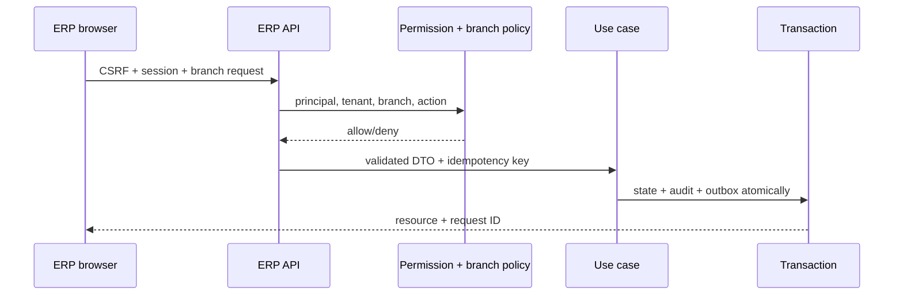

# ERP Security Model

## Principals and isolation

- Customer identity remains isolated from staff identity.
- Staff permissions use explicit capabilities, tenant membership and branch assignments.
- Tenant administrator is an explicit audited override; Super Admin is not inferred from lack of a restricted role.
- Policies apply at query and command boundaries; UI hiding is never authorization.

## Permission examples

`pos.use`, `orders.void`, `orders.refund`, `discounts.override`, `kitchen.view`, `inventory.receive`, `inventory.adjust`, `purchasing.approve`, `accounting.post`, `accounting.close_period`, `employees.manage`, `reports.financial`, `integrations.manage`.

## Controls

- MFA and recent re-authentication for finance, user/role, secret and export operations.
- HttpOnly/Secure/SameSite cookies, CSRF, short idle sessions and device/session revocation.
- Secret manager only; no runtime `.env` writes or secret values in API responses.
- Provider-hosted/tokenized payments only; no PAN/CVC through Laravel.
- Encrypted sensitive columns where justified, TLS, backups encryption and least-privilege DB accounts.
- Rate limiting by principal/tenant/IP and webhook replay protection.
- Immutable audit entries for login, permission, price, void/refund, stock, purchasing, journals, exports and configuration.
- Signed/expiring receipt access; PII minimization and retention/erasure workflows.

## Security release gates

Threat model, SAST/dependency/secret scans, authorization matrix tests, payment webhook tests, tenant/branch IDOR tests, log redaction, backup restore rehearsal and independent review are mandatory before production.
