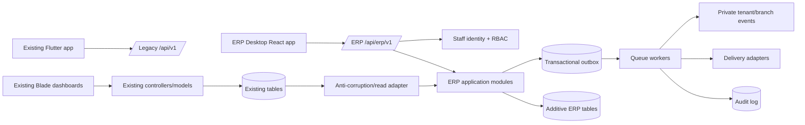

# Restaurant ERP System Architecture

## Architectural intent

Retain Laravel and Flutter unchanged at their existing boundaries, then add a modular monolith ERP backend and a separate React desktop frontend. A modular monolith minimizes operational complexity while creating enforceable domain boundaries that can later become services if scale demands it.

## Runtime boundaries

- **Legacy mobile boundary:** frozen `/api/v1`, existing models/tables and Flutter responses.
- **ERP HTTP boundary:** `/api/erp/v1`, staff-only session authentication, CSRF, permission and branch middleware, request DTO validation.
- **Domain boundary:** pure PHP value objects and aggregates under `app/ERP/Domain`; no framework/database calls.
- **Application boundary:** use cases, authorization decisions, transactions, idempotency, audit and ports under `app/ERP/Application`.
- **Infrastructure boundary:** Eloquent persistence, Stripe/delivery/printer adapters, queue/outbox implementations.
- **Presentation boundary:** React TypeScript desktop application in `erp-desktop`.

## Module responsibilities

| Module | Owns | Publishes |
|---|---|---|
| POS/Orders | carts, immutable price snapshot, order state | OrderPlaced, OrderAccepted, OrderCompleted |
| Payments | attempts, tenders, split/refund state, reconciliation | PaymentAuthorized/Captured/Refunded |
| Kitchen | tickets, stations, timers, availability | TicketStarted/Ready |
| Inventory | items, UOM, lots, movement ledger, counts | StockMoved, StockBelowThreshold |
| Recipes/Costing | versions, ingredients, yield and standard cost | RecipeActivated, StandardCostChanged |
| Purchasing | supplier, request, PO, GRN, invoice matching | GoodsReceived, SupplierInvoiceApproved |
| Accounting | chart, balanced journals, periods, tax | JournalPosted, PeriodClosed |
| Workforce | employee, branch assignment, roles, shifts | ShiftOpened/Closed |
| CRM/Loyalty | profiles, segments, points ledger | PointsEarned/Redeemed |
| Integrations | provider mappings/webhooks/retries | ExternalOrderImported |
| Reporting | read models and reconciled KPI definitions | no authoritative writes |

## Reliability principles

- Database transaction owns each state change and an outbox record.
- Consumers are at-least-once and idempotent using event/idempotency keys.
- Payments, inventory and journals are append-oriented; corrections use reversals.
- Order status transitions are explicit and audited.
- KDS can temporarily poll a branch-scoped projection if WebSockets are unavailable.
- Reporting never becomes the system of record.

## Desktop requirements

The shell is optimized for 1920×1080, 1440×900 and 1366×768 with a minimum supported application viewport of 1024px. POS controls use generous targets; management tables prioritize density. RTL flips logical layout via `dir`, not duplicated screens. Keyboard search/actions and reduced-motion/accessibility states are first-class.

## Not implemented in this foundation

Production authentication, ERP routes, migrations, queues, WebSockets, printers, delivery platforms and live financial posting are deliberately not connected. The foundation supplies contracts, architecture, demonstration UI and pure domain tests.
